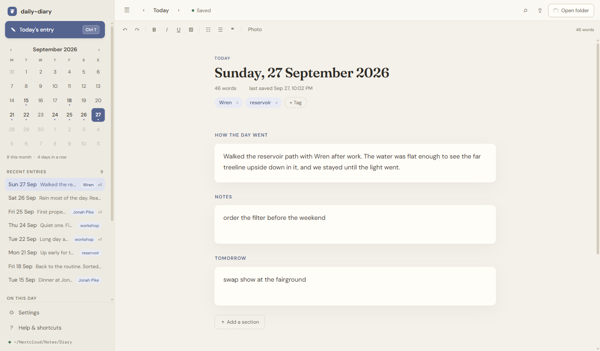
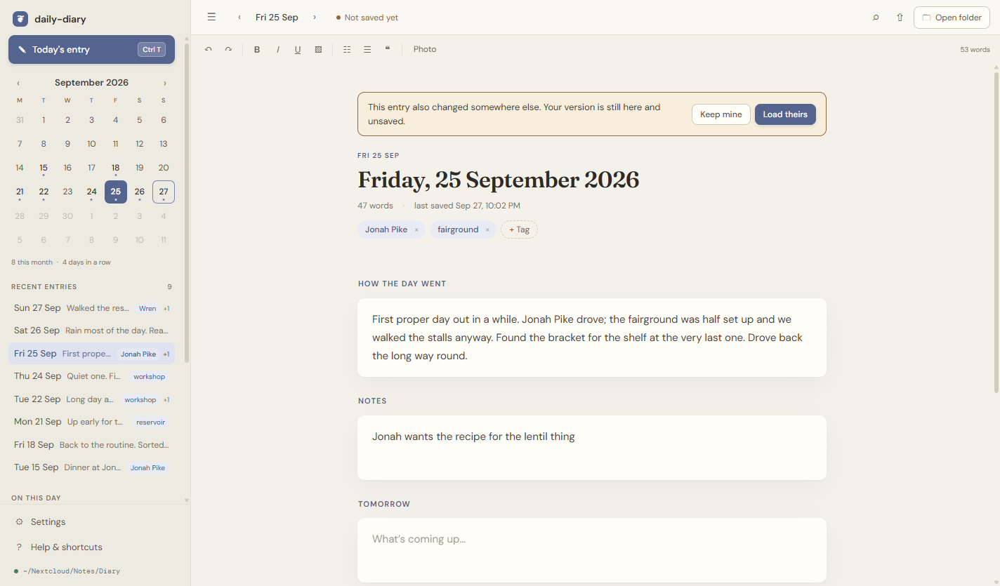
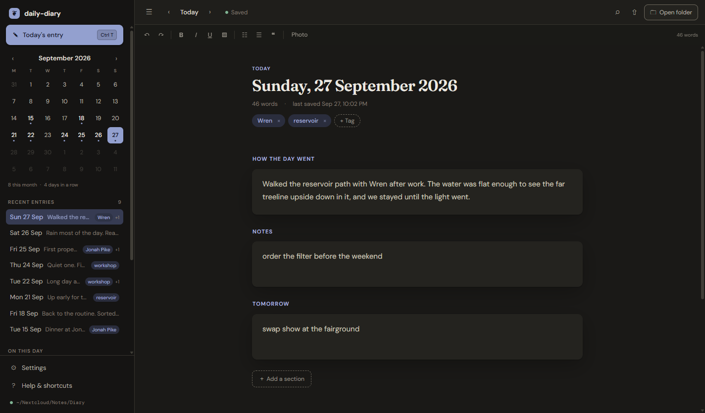
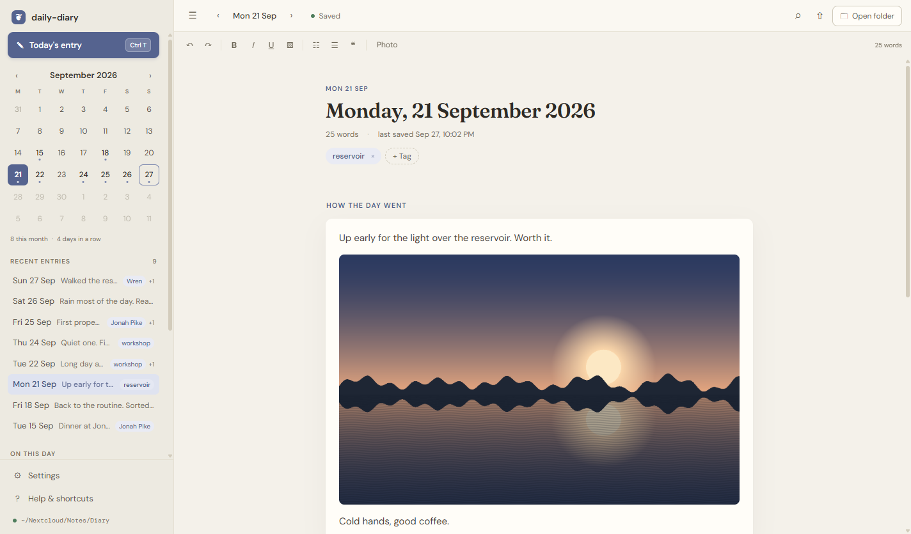
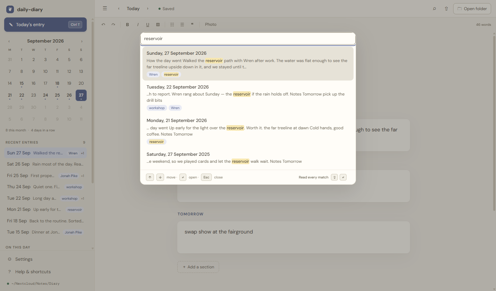
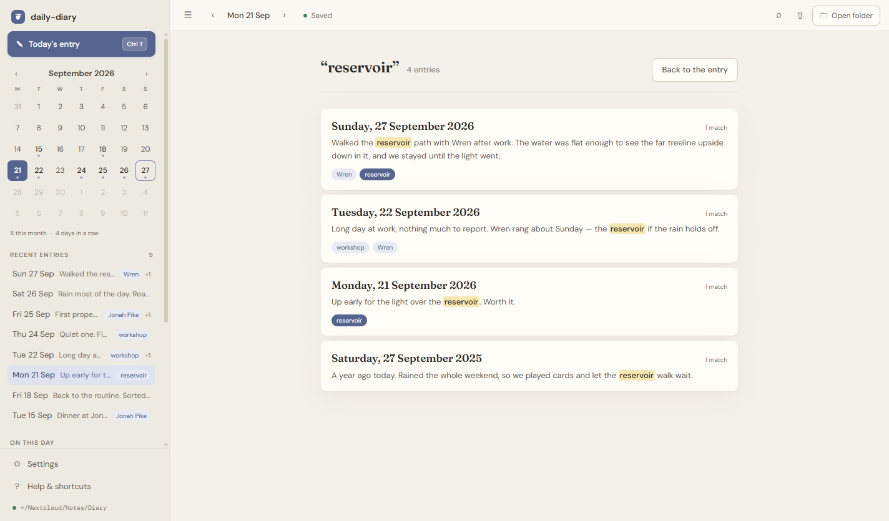
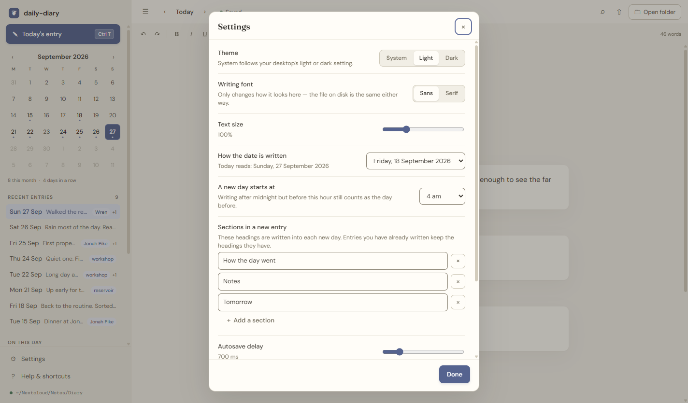

<div align="center">


# daily-diary

**A daily diary that writes plain Markdown into your Nextcloud folder.**

Open it and today's entry is already there — the date at the top, your headings underneath,
the cursor in the first one. One file per day, in a folder you own, so the same diary opens
on every device your Nextcloud client reaches.




</div>

---

## How an entry is stored

`~/Nextcloud/Notes/Diary/2026-09-18.md`, and nothing else:

```markdown
# Friday, 18 September 2026

Tags: Jonah Pike, camping

## How the day went

Walked the reservoir path after work...

## Notes

ring the parts place back

## Tomorrow

swap show at the fairground
```

The `Tags:` line is optional and only appears once you tag something. No frontmatter, no
database, no index file, no dotfolder. The date is the filename, the
sections are the headings, and that is the whole format. It is deliberately the same thing
**Nextcloud Notes** already shows you, so the diary reads properly in the Nextcloud web app
and on your phone even when this app is nowhere near.

Anything in the folder that is not named `YYYY-MM-DD.md` is ignored and never written to —
which is also how Nextcloud's `(conflicted copy)` files stay out of your way instead of
turning up as phantom entries.

## Syncing

Point it at a folder inside the one your Nextcloud client syncs and there is nothing else to
set up. Settings ▸ **Diary folder** ▸ Change…, or it finds `~/Nextcloud/Notes/Diary` by
itself on first run.

Two things make this actually work rather than nearly work:

**Entries written elsewhere show up.** `fs.watch` is unreliable on exactly the kind of folder
this app is for — a Nextcloud folder routinely gains a file with no event fired at all — so
the folder is also polled slowly, and again the moment you come back to the window.

**Nothing is overwritten behind your back.** If a day changes on another device while you are
looking at it, and you have not typed anything, it just reloads and says so. If you *were*
mid-sentence, both versions are kept and the app stops saving until you say which one wins:



Until you answer, nothing is written to that file. The one exception is closing the app,
where what you just typed wins — the other version is still on the device that wrote it, and
in Nextcloud's own file history.

## Light and dark

The theme follows your desktop by default, or you can pin it. Every colour is a token, so
both themes are designed rather than inverted.

<table>
<tr>
<td width="50%"></td>
<td width="50%"></td>
</tr>
<tr>
<td align="center"><sub><b>Light</b></sub></td>
<td align="center"><sub><b>Dark</b></sub></td>
</tr>
</table>

## Tags

Tag a day with the people, places and things in it — chips under the date, or
<kbd>Ctrl</kbd> <kbd>⇧</kbd> <kbd>A</kbd>. As you type, it suggests tags already in your
diary, so the same person gets the same tag every time instead of three spellings.

Tags show at the end of each row in **Recent entries**, and the sidebar grows a **Tags**
list with counts. Click one and the main panel fills with every day carrying it — date,
the opening lines, and its other tags — newest first. Click an entry to open it, or take
the same tag, Escape, or **Back to the entry** to return to what you were writing.

Because they live on one plain line, a tag is also just `grep -l "camping" ~/Nextcloud/Notes/Diary/*.md`
away, and reads as an ordinary line in Nextcloud Notes on your phone.

## Photos



**Photo** in the toolbar, <kbd>Ctrl</kbd> <kbd>⇧</kbd> <kbd>P</kbd>, paste one in, or drag
files onto the day you are writing. Click a photo to select it and <kbd>Delete</kbd> to
remove it — the file goes to your system trash, not straight to oblivion. Double-click opens
it full size in whatever your desktop uses for pictures.

Photos are **copied in exactly as they are** — full resolution, nothing re-encoded, nothing
stripped, which does mean a photo's own metadata travels with it. They live in a folder
beside the day, referenced by a plain relative path:

```
Notes/Diary/
  2026-09-20.md            
  2026-09-20-assets/
    photo-1.jpg
```

Deleting a day sends its photos to the trash with it.

Two things worth knowing. **Nextcloud Notes will not render them on your phone** — it does
not resolve relative image paths, so you will see the caption where the photo is. The files
still sync and open normally in the Nextcloud Files app. And **iPhone HEIC will not work**:
Chromium cannot decode it, so convert to JPEG first. JPEG, PNG, GIF, WebP, BMP and AVIF are
all fine.

## Getting back to a day



- **The calendar** marks every day you wrote on. Click one to open it.
- **Recent entries** is the last handful, newest first.
- **On this day** is the same date in earlier years, once you have them.
- <kbd>Ctrl</kbd> <kbd>K</kbd> searches every entry you have ever written — the writing,
  your headings, your tags and your photo captions. Several words narrow it down rather
  than finding nothing. <kbd>↵</kbd> jumps to a day; <kbd>⇧</kbd> <kbd>↵</kbd>, or **Read
  every match**, lays them all out instead (below).
- <kbd>Alt</kbd> <kbd>←</kbd> / <kbd>→</kbd> step a day at a time; add <kbd>⇧</kbd> to skip
  to the next day you actually wrote on.

## Reading every mention of something



Sometimes you do not want to jump to one day, you want to see every time you wrote about
something. <kbd>⇧</kbd> <kbd>↵</kbd> in the search box fills the main panel with each entry
that matches, showing only the paragraphs the word appears in, with every occurrence marked
and counted. The same view a tag gives you. Click an entry to open it; <kbd>Esc</kbd> or
**Back to the entry** returns to writing.

## Settings



- **Sections in a new entry** — the headings each new day is created with. Rename them, add
  your own, drop one. Entries you have already written keep the headings they have; the app
  does not reach back into last week to reorganise it.
- **How the date is written** — `Friday, 18 September 2026`, `Friday, September 18, 2026`,
  `Fri 18 Sep 2026`, or `2026-09-18`. It is rewritten from the filename on every save, so
  changing this is not a rename.
- **A new day starts at** — writing at 1am is almost always about yesterday. By default the
  diary day turns over at 4am, not midnight.
- **Writing font** — sans or serif. This only changes how it looks here; the file is
  identical either way.
- **Bedtime reminder** — off by default. Switch it on and pick a time, and you get a
  notification then if the day has no entry yet; write something and it stays quiet. On
  the desktop it only fires while the app is open. On Android it fires whether or not the
  app is open, and the permission is asked for when you switch it on.
- Theme, text size, autosave delay, spell check, and where the diary lives.

## Writing

Bold, italics, underline, highlight, lists, and quotes, with the usual keys. It stays
Markdown on disk the whole time — `**bold**`, `- lists`, `> quotes` — so nothing here is a
format only this app can read.

Pasting brings the text and not the formatting, which is nearly always what was meant.

Edits autosave 700 ms after you stop typing, and again when you leave the window or close the
app. Writes are **atomic**: an entry is written to a temp file, fsynced, and renamed, so a
crash mid-save cannot leave you with half a day. Deleting an entry moves it to the **system
trash**, never straight to oblivion.

## Keyboard shortcuts

| Shortcut | Action |
| --- | --- |
| <kbd>Ctrl</kbd> <kbd>T</kbd> | Today's entry |
| <kbd>Alt</kbd> <kbd>←</kbd> / <kbd>→</kbd> | Previous / next day |
| <kbd>Alt</kbd> <kbd>⇧</kbd> <kbd>←</kbd> / <kbd>→</kbd> | Previous / next entry written |
| <kbd>Ctrl</kbd> <kbd>⇧</kbd> <kbd>P</kbd> | Add a photo |
| <kbd>Ctrl</kbd> <kbd>⇧</kbd> <kbd>A</kbd> | Add a tag |
| <kbd>Ctrl</kbd> <kbd>G</kbd> | Jump to a date |
| <kbd>Ctrl</kbd> <kbd>K</kbd> | Search your diary |
| <kbd>Ctrl</kbd> <kbd>S</kbd> | Save now |
| <kbd>Ctrl</kbd> <kbd>E</kbd> | Export this entry |
| <kbd>Ctrl</kbd> <kbd>⇧</kbd> <kbd>⌫</kbd> | Delete this entry (to trash) |
| <kbd>Ctrl</kbd> <kbd>B</kbd> / <kbd>I</kbd> / <kbd>U</kbd> | Bold, italic, underline |
| <kbd>Ctrl</kbd> <kbd>,</kbd> | Settings |
| <kbd>Ctrl</kbd> <kbd>/</kbd> | Shortcuts |
| <kbd>Ctrl</kbd> <kbd>\</kbd> | Toggle the sidebar |
| <kbd>Ctrl</kbd> <kbd>⇧</kbd> <kbd>D</kbd> | Toggle dark mode |

## Run from source

```bash
npm install
npm start
npm run check   # syntax-check every source file
npm test        # 106 tests
```

If `npm start` stops with *"The SUID sandbox helper binary … is not configured correctly"*,
that is Chromium's sandbox rather than this app. Either run `npm start -- --no-sandbox`, or
fix it once for this checkout:

```bash
sudo chown root:root node_modules/electron/dist/chrome-sandbox
sudo chmod 4755 node_modules/electron/dist/chrome-sandbox
```

Packaged builds do not have this problem.

## Build installers

```bash
npm run icons        # regenerate build/icon.png and build/icon.ico
npm run dist:linux   # AppImage + deb + rpm
npm run dist:win     # NSIS installer + portable .exe
npm run dist:mac     # dmg + zip
npm run pack         # unpacked build, no installer
```

Linux artifacts cannot be produced from a Windows host — electron-builder needs a Linux
machine or Docker.

## Project layout

| File | Role |
| --- | --- |
| `src/entry.js` | The file format. Dates, parsing, and writing an entry back out. Pure — no fs, no Electron, no DOM |
| `src/diary.js` | The only module that touches diary files: atomic writes, trash, listing |
| `src/main.js` | Electron main process: window, IPC, settings, the folder watcher and poll |
| `src/preload.js` | The `window.diaryApp` bridge exposed to the page |
| `src/menu.js` | Application menu and accelerators |
| `src/window-state.js` | Window bounds, restored only onto a display that still exists |
| `src/store.js` | The renderer's cache of the folder; the calendar, "on this day" and search read from it |
| `src/settings.js` | Settings accessor; applies theme and text size |
| `src/markdown.js` | Markdown ↔ editor HTML, and the HTML sanitiser |
| `src/renderer.js` | UI wiring: the day you are on, the sections, autosave, conflicts |
| `src/ui/dialog.js` | Focus-trapped dialog primitive, `confirm()` and `prompt()` |
| `src/ui/search.js` | The search palette |
| `src/styles.css` | Design tokens, light and dark |

## On your phone (Android)

The same diary, the same folder, on Android. `mobile/` wraps this app's own page — the
editor, tags, photos, search, the conflict notice — so nothing is a second design to keep in
step. What changes is where the files come from: there is no Nextcloud client doing the
syncing on a phone, so the app talks to your Nextcloud itself.

- **Logging in** uses Nextcloud's own login page, in your phone's browser (Login Flow v2).
  The app gets a password of its own, never sees your real one, and shows up under
  Settings ▸ Security in Nextcloud, where it can be revoked on its own. It is stored
  encrypted with a key in the Android Keystore.
- **Pick the folder** the desktop app uses — it finds `Notes/Diary` by itself, and says how
  many entries it can see there before you commit.
- **It works offline.** The phone keeps a copy of every entry and writes to that; changes go
  up when Nextcloud is reachable again — when you open the app, every minute while it is
  open, and as you leave it.
- **Nothing is overwritten.** If a day changed on another device while the phone had its own
  unsent changes to it, both are kept, neither is uploaded, and the page asks which one
  wins — the same notice and buttons as the desktop.
- **Photos** come down as you open the day they belong to, not all at once, and go up
  byte for byte. Deleting a day or a photo moves it to your Nextcloud trash bin.
- **The bedtime reminder** is handed to Android a month ahead, one evening at a time, and
  rescheduled every time you open the app, save, or sync in a day written elsewhere. So it
  keeps coming if you forget the app for a few weeks, and a day you wrote on the laptop
  does not nag you on the phone.
- **https only.** Release builds refuse plain-http servers, because the login travels with
  every request.

### Build the APK

Needs Node 20+ and Android Studio (or just its SDK). Gradle fetches the Java 21 toolchain the
Capacitor plugins want by itself.

```bash
cd mobile
npm install
npm run apk          # -> android/app/build/outputs/apk/debug/app-debug.apk
```

Install it with `adb install` or by copying the APK to the phone.

Each tagged release also builds a signed `daily-diary-<version>-android.apk` and attaches it
to the GitHub release, next to the desktop installers. How the signing key works, and how to
build a signed APK yourself, is in [mobile/SIGNING.md](mobile/SIGNING.md).

To try it without a real server, `npm run fake-server` runs a stand-in Nextcloud on port
8480 (log in from the emulator at `http://10.0.2.2:8480`; debug builds allow plain http for
exactly this).

| File | Role |
| --- | --- |
| `mobile/src/bridge.js` | `window.diaryApp` for Android — the phone's stand-in for `src/preload.js` |
| `mobile/src/sync.js` | Two-way sync between the phone's copy and the server, conflicts included |
| `mobile/src/dav.js` | The WebDAV the sync needs, with conditional writes |
| `mobile/src/setup.js` | Login Flow v2 and the folder picker |
| `mobile/android/…/NextcloudPlugin.java` | HTTP (PROPFIND and friends), the Keystore-sealed app password, photo streaming |
| `mobile/build-www.js` | Builds the app's web assets from `index.html` and `src/` |
| `mobile/tools/fake-nextcloud.js` | A stand-in server for the tests and the emulator |

## Privacy

The desktop app makes no network requests. The Android app talks to one server: yours. Fonts are bundled locally, the Content Security Policy
sets `connect-src 'none'`, and nothing is sent anywhere. Your diary stays on your disk, and
goes wherever your own Nextcloud server is.

## License

Proprietary — free to use, not to sell, modify, or redistribute. See [LICENSE](LICENSE).

The bundled DM Sans, DM Mono and Fraunces typefaces are separately licensed under the SIL
Open Font License 1.1 (`src/fonts/OFL.txt`), as are Electron and the npm dependencies under
their own terms.
